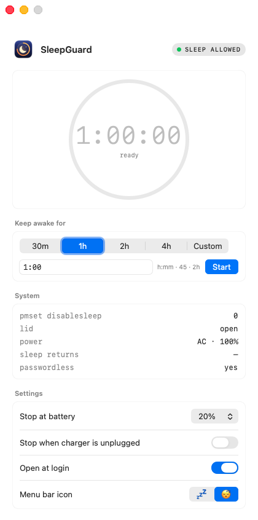
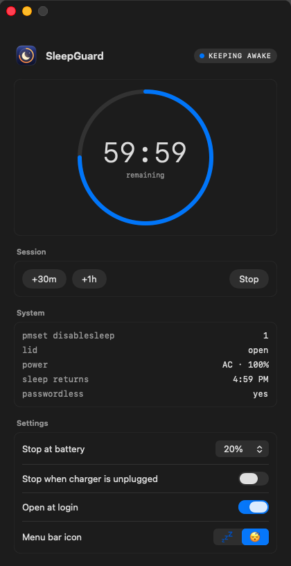

<p align="center">
  
</p>

<h1 align="center">SleepGuard</h1>

<p align="center">
  Keep your Mac awake, <b>lid closed too</b>, for exactly as long as you choose.<br>
  Every block ends on its own. Never forever.
</p>

<p align="center">
  
  &nbsp;&nbsp;
  
</p>

---

## Why

Apps like `caffeinate` stop a Mac from *idle* sleeping, but closing the lid still puts it to sleep.
The only switch that keeps a MacBook awake with the lid closed is:

```bash
sudo pmset -a disablesleep 1
```

That setting stays on until you turn it off. Forget, and your Mac runs in your bag
until the battery is empty and it's hot.

SleepGuard wraps that switch in **timed blocks that always end**: when the timer runs out,
when the battery gets low, when you unplug (optional), when you press Stop, or when you quit the app.

## Features

- **Timed blocks:** 30 min, 1 h, 2 h, 4 h, or any custom time up to 24 h (`45`, `1:30`, `2h`).
  Extend a running block with +30m / +1h.
- **Works with the lid closed.** When a block ends with the lid closed, the Mac goes to sleep straight away
  (unless it's docked to an external display).
- **Battery cutoff:** ends the block at 10–50% battery (20% by default), and won't start one below it.
- **Stop when unplugged** (optional): ends the block when the charger is disconnected.
- **Menu bar + window:** a menu bar icon with a live countdown, and a window with a live countdown ring,
  system readouts and settings. Follows light and dark mode.
- **Catches forgotten blocks:** if sleep was disabled some other way (for example a manual `sudo pmset`),
  SleepGuard turns it back on as soon as you close the lid.
- **Fail-safe:** if SleepGuard crashes or is force-quit, a small background job turns sleep back on within a minute.
- **Password once, ever:** a one-time setup lets it switch sleep on and off without asking again.
- No network access, no analytics, no dependencies. About 1,000 lines of Swift you can read.

## Menu bar

| Icon | Meaning |
|---|---|
| Crossed 💤 + time left | SleepGuard is keeping the Mac awake |
| Faded 💤 | Sleep allowed, as normal |
| Crossed 💤 + orange `!` | Sleep is disabled by something else. It's turned back on when you close the lid |

You can switch the icon to 😴 in Settings.

## Requirements

- macOS 14 Sonoma or later, Apple silicon or Intel
- Apple's Command Line Tools, to compile it (a one-time download from Apple). If you've never installed them:

  ```bash
  xcode-select --install
  ```

  If you already have Xcode, you're set.

## Install

1. **Download and build.** In Terminal:

   ```bash
   git clone https://github.com/praveenkumarp98/SleepGuard.git
   cd SleepGuard
   ./install.sh
   ```

   This builds the app on your Mac (about a minute), installs it to `~/Applications/SleepGuard.app`,
   adds the small fail-safe job, and opens the app. It needs no admin password.

2. **Look for 💤 in your menu bar.** The SleepGuard window also opens. macOS may show a
   *"Background Items Added"* notification: that's SleepGuard's *Open at login* setting, which you can
   turn off in the app.

3. **One-time setup.** The first time you start a block (or click **Set Up…** in the window),
   SleepGuard explains what it needs and asks for your Mac password **once**. See
   [What the one-time setup does](#what-the-one-time-setup-does).

Because you build the app yourself, macOS doesn't show the "unidentified developer" warning.

## Use

**Start a block.** Click 💤 in the menu bar and pick a duration, or open the window
(Spotlight → "SleepGuard", or **Open SleepGuard…** in the menu), choose a preset or type a time, and press **Start**.

**While it runs:**
- The menu bar shows the time left. The window shows a countdown ring and when sleep returns.
- You can add time (**+30m**, **+1h**) or **Stop** at any point.
- You can close the lid and the Mac stays awake.

**When the block ends:** sleep is turned back on. If the lid is closed, the Mac goes to sleep straight away.

**Settings** (in the window; the battery ones are also in the menu):

| Setting | Default | What it does |
|---|---|---|
| Stop at battery | 20% | Ends the block when the battery drops to this level (on battery power) |
| Stop when charger is unplugged | Off | Ends the block when you unplug |
| Open at login | On | Starts SleepGuard when you log in |
| Menu bar icon | 💤 | 💤 or 😴 |

Closing the window keeps SleepGuard running in the menu bar. **Quit SleepGuard** (in the menu)
turns sleep back on before quitting.

## Update

```bash
cd SleepGuard
git pull
./install.sh
```

## Uninstall

```bash
cd SleepGuard
./uninstall.sh
```

This turns sleep back on if needed, removes the app, its login item, the fail-safe job, its settings,
and the sudoers rule. It asks for your password for that last step. Then you can delete the `SleepGuard` folder.

<details>
<summary>Uninstall by hand (if you've deleted the folder)</summary>

```bash
~/Applications/SleepGuard.app/Contents/MacOS/SleepGuard --unregister-login
pkill -x SleepGuard
launchctl bootout gui/$(id -u)/local.sleepguard.failsafe
rm -f ~/Library/LaunchAgents/local.sleepguard.failsafe.plist
rm -rf ~/Applications/SleepGuard.app "$HOME/Library/Application Support/SleepGuard"
defaults delete local.sleepguard
sudo pmset -a disablesleep 0
sudo rm -f /etc/sudoers.d/sleepguard
```

</details>

## How it works

### What the one-time setup does

Changing `disablesleep` needs admin rights. Instead of asking for your password every time
(and getting stuck on a password prompt when a block ends while the lid is closed), the setup adds one file,
`/etc/sudoers.d/sleepguard`:

```
<your-username> ALL=(root) NOPASSWD: /usr/bin/pmset -a disablesleep 0, /usr/bin/pmset -a disablesleep 1
```

It allows exactly those two commands and nothing else. It's checked with `visudo` before it's installed.
The trade-off: any program running as you could also switch sleep off or on without a password.
Remove the file (or run `./uninstall.sh`) to undo it.

### What gets installed

| Path | What it is |
|---|---|
| `~/Applications/SleepGuard.app` | The app |
| `~/Library/LaunchAgents/local.sleepguard.failsafe.plist` | Runs the fail-safe every 60 s |
| `~/Library/Application Support/SleepGuard/failsafe.sh` | If sleep is disabled and SleepGuard isn't running, turns sleep back on |
| `/etc/sudoers.d/sleepguard` | The one-time setup rule (only after you approve it) |
| `~/Library/Preferences/local.sleepguard.plist` | Your settings |

### Under the hood

- It reads the lid state, `SleepDisabled` and the battery straight from macOS (IOKit), every 5 seconds.
- A block ends with `pmset -a disablesleep 0`. If the lid is closed and no external display is driving the Mac,
  `pmset sleepnow` follows.
- The code is plain AppKit + SwiftUI in two files, `main.swift` (logic, menu bar) and `Window.swift` (window),
  built with `swiftc` by `install.sh`. There's no Xcode project.

## Troubleshooting

**I don't see 💤 in the menu bar.** On MacBooks with a notch, menu bar icons can hide behind it when the bar is full.
Quit a few other menu bar apps, or open the window from Spotlight ("SleepGuard").

**"passwordless: not set up" in the window.** Click **Set Up…** and enter your password. If it still says
*not set up*, check that `/etc/sudoers.d/sleepguard` exists.

**The Mac didn't go to sleep when the block ended.** If it's connected to an external display and power,
macOS keeps it awake with the lid closed (clamshell mode). That's normal. Sleep *is* back on.

**`install.sh` says the Swift compiler isn't found.** Run `xcode-select --install`, then run `./install.sh` again.

**Check what SleepGuard sees:**

```bash
~/Applications/SleepGuard.app/Contents/MacOS/SleepGuard --status
```

## Development

| File | Purpose |
|---|---|
| `main.swift` | Sleep/lid/battery logic, menu bar, one-time setup |
| `Window.swift` | The SwiftUI window |
| `makeicon.swift` | Draws the app icon (edit colours/shapes here) |
| `install.sh` / `uninstall.sh` | Build + install / remove everything |
| `failsafe.sh` | The fail-safe job's script |

`SleepGuard --snapshot <dir>` renders the window (idle and running, light and dark) to PNGs.
It's how the screenshots in `docs/` were made.

Inspired by [Amphetamine](https://apps.apple.com/app/amphetamine/id937984704) (battery cutoff, fail-safe),
[Lungo](https://sindresorhus.com/lungo) (stop when unplugged) and Theine (duration menu).

## License

[MIT](LICENSE): free to use, change and share. Provided as is, without warranty.
